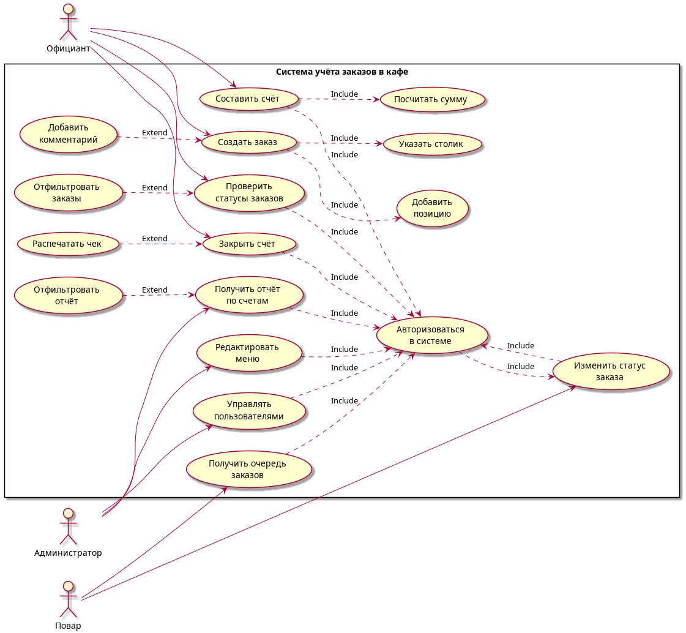

# Система учёта заказов в кафе

**TUI-приложение для автоматизации учёта и обработки заказов в кафе**

---

## О проекте

Информационная система предназначена для **учёта заказов в кафе**. Она обеспечивает регистрацию и обработку заказов, контроль их состояния, формирование счетов и получение отчётности о работе заведения.

Система реализована в виде **TUI-приложения** (Text User Interface) — взаимодействие с пользователем происходит через текстовый интерфейс терминала.

### Цель системы

Автоматизация учёта и обработки заказов в кафе.

### Задачи системы

- создание и редактирование заказов;
- указание столика и позиций заказа;
- добавление комментариев к заказу;
- просмотр и фильтрация заказов;
- контроль статусов заказов;
- передача заказов повару;
- формирование и расчёт счёта;
- закрытие счёта;
- печать чека;
- управление меню;
- управление пользователями;
- формирование отчётов по счетам.

---

## Пользователи и роли

В системе предусмотрено **три типа пользователей**.

### Официант

| Возможность           | Описание                |
| --------------------- | ----------------------- |
| Авторизация           | Вход в систему          |
| Создание заказа       | Новый заказ для столика |
| Указание столика      | Привязка заказа к столу |
| Добавление позиций    | Выбор блюд из меню      |
| Комментарии           | Примечания к заказу     |
| Просмотр и фильтрация | Список заказов          |
| Проверка статусов     | Отслеживание состояния  |
| Формирование счёта    | Расчёт суммы            |
| Закрытие счёта        | Оплата гостем           |
| Печать чека           | Вывод чека              |

### Повар

- авторизация в системе;
- получение очереди заказов;
- просмотр информации о заказах;
- изменение статуса заказа.

### Администратор

- авторизация;
- редактирование меню;
- управление пользователями;
- получение отчётов по счетам;
- фильтрация отчётов.

---

## Основные функции системы

1. Авторизация пользователей.
2. Создание заказа.
3. Добавление позиций в заказ.
4. Указание столика.
5. Добавление комментария к заказу.
6. Просмотр и фильтрация заказов.
7. Получение очереди заказов для повара.
8. Изменение статуса заказа.
9. Формирование счёта.
10. Расчёт суммы заказа.
11. Закрытие счёта.
12. Печать чека.
13. Редактирование меню.
14. Управление пользователями.
15. Формирование и фильтрация отчётов по счетам.

---

## Архитектура

Для разработки используется **многослойная архитектура** (Layered Architecture), которая разделяет интерфейс, бизнес-логику и работу с данными.

| Слой                     | Назначение                                                           |
| ------------------------ | -------------------------------------------------------------------- |
| **Presentation Layer**   | TUI-интерфейс приложения                                             |
| **Business Logic Layer** | Обработка заказов, проверка данных, расчёт суммы, изменение статусов |
| **Data Layer**           | Хранение и получение данных о пользователях, меню, заказах и счетах  |

### Технологии

- **Язык программирования:** Go
- **СУБД:** SQLite
- **Интерфейс:** TUI (Text User Interface)
- **Контроль версий:** Git + GitHub
- **Документация:** Markdown, PlantUML

---

## Структура проекта

```
okeeper/
├── .git/                  # Служебная папка Git
├── README.md              # Описание проекта
├── .gitignore             # Исключения Git
├── go.mod                 # Модуль Go
├── go.sum                 # Зависимости
├── cmd/
│   └── main.go            # Точка входа
├── internal/
│   ├── presentation/      # TUI-интерфейс
│   ├── business/          # Бизнес-логика
│   └── data/              # Работа с SQLite
├── docs/
│   └── diagrams/          # Диаграммы PlantUML
│       ├── use_case.puml
│       ├── use_case.png
│       ├── activity_waiter.puml
│       ├── activity_waiter.png
│       ├── activity_cook.puml
│       ├── activity_cook.png
│       ├── activity_admin.puml
│       └── activity_admin.png
└── tests/                 # Автоматизированные тесты
```

---

## Диаграммы

### Use Case — диаграмма вариантов использования



### Activity — диаграмма деятельности официанта


### Activity — диаграмма деятельности повара


### Activity — диаграмма деятельности администратора


---

## Установка и запуск

### Требования

- Go 1.21+
- SQLite 3

### Клонирование репозитория

```bash
git clone https://github.com/TimNikolaev/OKeeper.git
cd okeeper
```

### Установка зависимостей

```bash
go mod download
```

### Запуск приложения

```bash
go run cmd/main.go
```

### Сборка бинарного файла

```bash
go build -o okeeper cmd/main.go
./okeeper
```

---

## Тестирование

```bash
go test ./...
```
